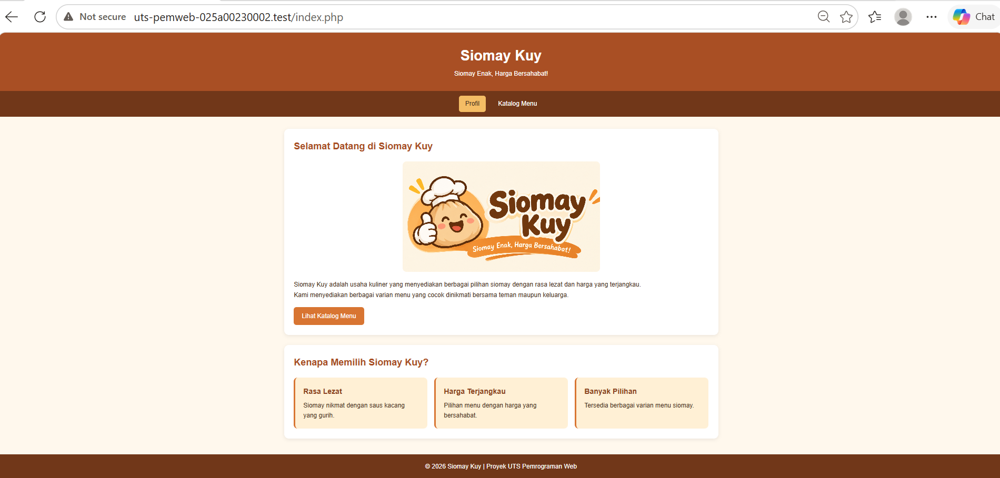
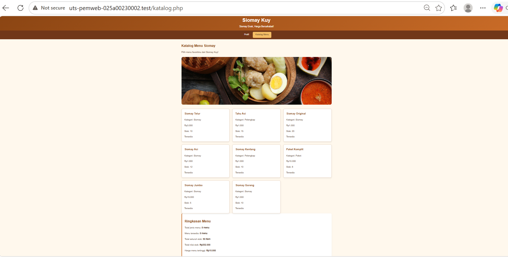

# Siomay Kuy — Katalog Menu UMKM

## 1. Identitas Mahasiswa

- **Nama:** Nikmatul Khoiriyah
- **NIM:** 025A00230002
- **Kelas:** A2-3A
- **Mata Kuliah:** Pemrograman Web
- **Program Studi:** Informatika

## 2. Deskripsi Proyek

Siomay Kuy merupakan website sederhana untuk memperkenalkan usaha kuliner siomay. Website ini memiliki dua halaman utama, yaitu halaman profil usaha dan halaman katalog menu. Pengunjung dapat melihat informasi menu, kategori, harga, stok, serta status ketersediaan setiap menu.

Website ini dibuat menggunakan PHP, HTML, dan CSS. Data menu disimpan dalam array PHP sehingga dapat ditampilkan secara dinamis tanpa menggunakan database.

## 3. Teknologi yang Digunakan

Proyek ini menggunakan HTML5 untuk struktur halaman, CSS3 untuk mengatur tampilan, dan PHP untuk mengolah serta menampilkan data. Git dan GitHub digunakan untuk mengelola proyek, sedangkan Laragon digunakan untuk menjalankan website secara lokal.

## 4. Struktur File

```text
uts-pemweb-025A00230002/
│
├── index.php
├── katalog.php
├── data.php
├── functions.php
├── style.css
├── README.md
├── .gitignore
│
├── assets/
│   ├── banner-katalog.png
│   └── logosiomaykuy.png
│
└── screenshots/
    ├── profil.png
    └── katalog.png
```

Keterangan:
- `index.php` — Halaman profil usaha.
- `katalog.php` — Halaman daftar menu dan ringkasan stok.
- `data.php` — Menyimpan delapan data menu dalam array PHP.
- `functions.php` — Menyimpan fungsi pengolahan data.
- `style.css` — Mengatur desain dan tampilan website.
- `assets/` — Menyimpan gambar logo dan banner.
- `screenshots/` — Menyimpan tangkapan layar website.
- `.gitignore` — Mengatur file yang tidak perlu dilacak Git.

## 5. Fitur Website

Website Siomay Kuy memiliki fitur halaman profil usaha yang berisi deskripsi dan keunggulan, serta halaman katalog yang menampilkan delapan jenis menu beserta kategori, harga, dan stok. Website juga menampilkan status ketersediaan menu dan ringkasan berupa jumlah menu, total stok, nilai stok, serta harga tertinggi. Navigasi disediakan agar pengunjung dapat berpindah antara halaman profil dan katalog.

## 6. Penerapan PHP

Dalam proyek ini, terdapat beberapa fungsi buatan sendiri yang disimpan di `functions.php`, yaitu:

- `e()` untuk mengamankan teks sebelum ditampilkan ke HTML.
- `formatRupiah()` untuk mengubah angka menjadi format mata uang rupiah.
- `hitungTotalStok()` untuk menghitung seluruh stok menu.
- `hitungNilaiStok()` untuk menghitung nilai seluruh stok menu.

Fungsi bawaan PHP yang digunakan adalah `count()` untuk menghitung jumlah data, `array_filter()` untuk menyaring menu yang tersedia, `array_column()` untuk mengambil data harga, dan `max()` untuk mencari harga tertinggi. Selain itu, `foreach` digunakan untuk menampilkan data menu, sedangkan `if` dan `else` digunakan untuk menentukan status ketersediaan menu.

## 7. Hasil Pengolahan Data

Berdasarkan data yang dimasukkan, website menghasilkan ringkasan berikut:

| Keterangan | Hasil |
|---|---:|
| Total jenis menu | 8 menu |
| Menu tersedia | 8 menu |
| Total seluruh stok | 90 item |
| Total nilai stok | Rp252.000 |
| Harga menu tertinggi | Rp15.000 |

## 8. Cara Menjalankan Website

1. Buka aplikasi Laragon.
2. Klik **Start All**.
3. Letakkan folder proyek di dalam folder `www` Laragon.
4. Buka browser.
5. Masukkan alamat berikut:

   `http://localhost/uts-pemweb-025A00230002/`

6. Klik menu **Katalog Menu** untuk melihat daftar menu dan ringkasan stok.

## 9. Screenshot Website





## 10. Sumber dan Bantuan

**Sumber referensi:**
- PHP: https://www.php.net/docs.php
- HTML: https://developer.mozilla.org/en-US/docs/Web/HTML
- CSS: https://developer.mozilla.org/en-US/docs/Web/CSS

**Penggunaan AI:**

ChatGPT digunakan sebagai alat bantu untuk memahami materi, menyusun dan memeriksa kode, memperbaiki tampilan CSS, serta menyusun dokumentasi. Kode diperiksa kembali dengan menjalankan website melalui Laragon dan menguji hasil tampilannya.

---

Proyek ini dibuat untuk memenuhi tugas Ujian Tengah Semester (UTS) mata kuliah Pemrograman Web, Program Studi Informatika, Tiga Serangkai University.
